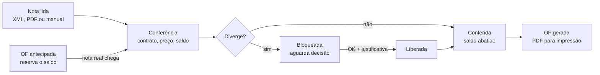

# PRD: Sistema de Conferência de Notas e Contratos

Oct 20, 2026 · @Segundo

Sistema web para conferir notas fiscais contra os contratos do Fundo Municipal de Saúde de Campo Maior, controlar saldos item a item e gerar ordens de fornecimento prontas para impressão, substituindo as planilhas de controle atuais.

## 1. Visão e objetivos

O objetivo é reduzir a conferência de notas de até 4 horas por dia para minutos, eliminando erros de soma, saldos errados e relatórios incompletos.

**Problema atual.** Cada contrato é controlado numa planilha própria, com uma coluna por nota fiscal e fórmulas de soma e subtração. A conferência de nome, valor unitário e saldo é manual, item a item, muitas vezes com 20 notas de uma mesma empresa. A análise das planilhas atuais encontrou 42 linhas com totais digitados à mão no contrato da Poty, valores gravados como texto que não somam e saldos negativos sem alerta.

**Objetivo.** Ler a nota (XML, PDF ou lançamento manual), casar cada item com o contrato correto, apontar divergências, abater saldo com precisão de centavos e gerar a ordem de fornecimento pronta para impressão.

**Sucesso em 6 meses.** Todas as conferências feitas no sistema, nenhuma planilha paralela, e o usuário com tempo livre no restante do dia. Indicadores sugeridos: tempo médio por nota, notas com divergência detectada e zero diferença de centavos entre OF e nota.

## 2. Escopo

O MVP cobre o ciclo completo de um usuário: contrato, nota, conferência, OF e relatório. Multiusuário e integrações externas ficam para a fase 2.

| Fase | Inclui |
| --- | --- |
| MVP | Cadastro de empresas, contratos, itens e aditivos; importação das planilhas atuais; leitura de nota por XML, PDF e lançamento manual; casamento automático com memória de vínculos; conferência com bloqueio e liberação justificada; OF antes ou depois da nota; geração de OF em PDF, em lote; relatórios em PDF; alerta de vencimento; backup automático |
| Fase 2 | Perfis gestor geral, gestor de setor e lançador; download automático de notas pela SEFAZ com certificado digital do órgão; extração assistida por IA para layouts desconhecidos; modo offline; conversão de unidade ativada na tela |
| Fora do escopo | Liquidação, pagamento e controle de empenho; emissão de notas; outras secretarias além da Saúde |

Restrição principal: o sistema não deve ganhar complexidade desnecessária, pois o primeiro usuário é também quem vai validar tudo.

## 3. Usuários e permissões

No MVP há um único usuário com acesso total. O banco de dados já nasce preparado para três perfis, até 3 pessoas, ativados na fase 2.

| Perfil | Pode | Fase |
| --- | --- | --- |
| Administrador (master) | Tudo, incluindo liberar notas com divergência, excluir notas e OF e gerenciar usuários | MVP |
| Gestor de setor | Ver todos os contratos, conferir, gerar OF e relatórios | Fase 2 |
| Lançador | Lançar notas e aditivos; não libera divergências nem exclui | Fase 2 |

Uso principal em computador e tablet, com interface responsiva para celular. Nível técnico dos usuários: médio a alto.

## 4. Entidades e dados

O sistema guarda 12 entidades. O saldo nunca é digitado: é sempre calculado a partir dos itens de nota e das reservas de OF.

| Entidade | Campos principais | Observações |
| --- | --- | --- |
| Contratante | Nome, CNPJ 11.753.492/0001-02, secretaria, logo | Configuração única: Fundo Municipal de Saúde de Campo Maior |
| Empresa | CNPJ, razão social | CNPJ único; identificada automaticamente pela nota |
| Contrato | Número (ex. 07.2909/2025), pregão (ex. PE 024/2025), empresa, início e fim da vigência, fiscal, solicitante, ordenador | Uma empresa pode ter vários contratos |
| Item do contrato | Lote (opcional), nº do item, descrição, unidade, quantidade contratada, origem (original ou aditivo) | Quantidade aceita casas decimais (ex. litros) |
| Preço do item | Valor unitário com até 4 casas, vigente a partir de | Histórico: cada reajuste cria um novo preço datado |
| Aditivo | Número, data de assinatura, tipo (quantidade, valor, prazo), itens afetados, arquivo de origem | Lançado um a um ou importado por arquivo |
| Nota fiscal | Chave de acesso, número, série, CNPJ do emitente, data de emissão, valor total, origem, PDF anexo, status, justificativa | Origem: XML, PDF, manual, importada ou provisória (OF antes da nota) |
| Item da nota | Código do fornecedor, descrição, unidade, quantidade, valor unitário, valor total, item do contrato vinculado, saldo de origem | Valor total gravado exatamente como na nota |
| Vínculo memorizado | Empresa, código do fornecedor, descrição normalizada, item do contrato, fator de conversão | Fator = 1 até a fase 2 |
| Ordem de fornecimento | Número/ano, nota, data de assinatura, status, PDF gerado | Uma OF por nota |
| Feriado | Data, descrição, abrangência (nacional, estadual, municipal) | Usado no cálculo do primeiro dia útil |
| Registro de auditoria | Usuário, data e hora, ação, valores antes e depois, justificativa | Toda liberação, edição e exclusão fica registrada |

## 5. Ciclo de vida da nota

A nota entra lida (XML, PDF ou manual) ou como OF antecipada, que reserva saldo até a nota real chegar. Uma nota bloqueada só avança com o OK do administrador e justificativa; excluir a nota em qualquer etapa devolve o saldo e exclui a OF vinculada.

## 6. Regras de negócio

São 20 regras. As mais críticas são RN05 (preço exato), RN07 (cálculo de saldo) e RN11 (bloqueio com liberação justificada).

| ID | Tema | Regra |
| --- | --- | --- |
| RN01 | Empresa | A empresa é identificada pelo CNPJ do emitente. Se não estiver cadastrada, o sistema oferece o cadastro com os dados da nota. |
| RN02 | Duplicidade | Uma nota com a mesma chave de acesso não pode ser lançada duas vezes. Sem chave, vale a combinação CNPJ + número + série. |
| RN03 | Contrato | O contrato é sugerido pelo número citado nas informações complementares; sem citação, pelo contrato da empresa cujos itens mais casam. O usuário confirma. Nota emitida fora da vigência é divergência. |
| RN04 | Casamento | Cada item da nota é casado nesta ordem: vínculo memorizado; descrição normalizada (sem acentos, pontuação e espaços extras) com o mesmo preço; semelhança de texto. Todo casamento confirmado vira vínculo memorizado. |
| RN05 | Preço | O valor unitário da nota deve ser exatamente igual ao preço vigente do item, sem tolerância. |
| RN06 | Reajuste | O preço de um aditivo de valor vale para notas emitidas na data de assinatura do aditivo ou depois. Notas anteriores seguem o preço antigo. |
| RN07 | Saldo | Quantidade disponível = contratada − faturada − reservada. Valor disponível = quantidade disponível × preço vigente. Todo cálculo é feito em decimal exato, nunca em ponto flutuante. |
| RN08 | Excedente | Quantidade que ultrapassa o saldo disponível é divergência. |
| RN09 | Unidade | A unidade escrita na nota é exibida, mas não bloqueia a conferência, pois fornecedores usam unidades inconsistentes (ex. "CXA" para comprimidos). |
| RN10 | Centavos | Os valores totais são gravados exatamente como estão na nota, e o total da OF é igual ao total da nota, ao centavo. Se quantidade × preço diferir do total da linha, o sistema mostra um alerta de arredondamento. |
| RN11 | Bloqueio | Qualquer divergência bloqueia a nota inteira. Ela só é liberada com o OK do administrador e uma justificativa escrita, que aparece no histórico e nos relatórios. |
| RN12 | Aditivo | Quando um item tem saldo original e saldo aditivado com o mesmo preço, o usuário escolhe de qual abater. |
| RN13 | OF antes da nota | A OF pode ser criada antes da nota, como nota provisória sem número. Seus itens reservam saldo. Quando a nota real chega, o usuário completa número e chave, e a reserva vira faturamento. Sem nota, a reserva permanece até a OF ser excluída. |
| RN14 | Exclusão e edição | Excluir uma nota devolve o saldo e exclui a OF vinculada. Editar uma nota recalcula o saldo e atualiza a OF. |
| RN15 | Numeração da OF | Cada nota gera uma OF. Em 2026 a OF sai sem número; a partir de 2027 a numeração é automática e sequencial, recomeçando em 001 a cada ano. |
| RN16 | Data da OF | A data de assinatura é o primeiro dia útil do mês de emissão da nota, desconsiderando fins de semana e feriados cadastrados, ou outra data escolhida pelo usuário. |
| RN17 | Vencimento | O sistema alerta 30 dias antes do fim da vigência e no dia do vencimento. |
| RN18 | Saldo negativo | Saldo negativo só surge por liberação justificada. Ao gerar cada relatório, o usuário escolhe mostrar o valor negativo ou zero com observação. |
| RN19 | Importação | Na importação das planilhas, os valores digitados são respeitados como estão, mesmo quando diferem da soma das notas. |
| RN20 | Auditoria | Toda liberação, edição e exclusão registra usuário, data, hora e valores antes e depois. |

## 7. Requisitos funcionais

São 22 requisitos, 18 deles no MVP.

| ID | Requisito | Prioridade |
| --- | --- | --- |
| RF01 | Cadastrar, editar e consultar empresas, contratos e itens | MVP |
| RF02 | Lançar aditivos de quantidade, valor e prazo, item a item ou por arquivo importado | MVP |
| RF03 | Importar as planilhas de controle atuais com tela de pré-visualização e mapeamento de colunas | MVP |
| RF04 | Ler nota por XML | MVP |
| RF05 | Ler nota por PDF (DANFE), inclusive com várias folhas e páginas extras | MVP |
| RF06 | Lançar nota manualmente, digitando ou colando o texto da descrição | MVP |
| RF07 | Mostrar tela de confirmação com os dados lidos antes de salvar a nota | MVP |
| RF08 | Sugerir contrato e casar itens automaticamente, com opção de corrigir o vínculo | MVP |
| RF09 | Apontar cada divergência por item: nome não encontrado, preço diferente, saldo insuficiente, contrato vencido | MVP |
| RF10 | Liberar nota bloqueada com justificativa obrigatória | MVP |
| RF11 | Histórico de notas por contrato, com seleção múltipla para gerar OF, editar ou excluir | MVP |
| RF12 | Criar OF antes da nota (nota provisória com reserva de saldo) | MVP |
| RF13 | Gerar OF em PDF, uma por nota, individualmente ou em lote | MVP |
| RF14 | Gerar relatórios em PDF com filtros e opções de exibição (seção 10) | MVP |
| RF15 | Painel com contratos a vencer em 30 dias e notas bloqueadas | MVP |
| RF16 | Cadastro de feriados para cálculo do primeiro dia útil | MVP |
| RF17 | Guardar o PDF original anexado à nota | MVP |
| RF18 | Backup automático diário e exportação completa sob demanda | MVP |
| RF19 | Perfis de usuário e permissões | Fase 2 |
| RF20 | Download automático de notas pela SEFAZ com certificado digital do órgão | Fase 2 |
| RF21 | Extração assistida por IA para layouts de nota desconhecidos | Fase 2 |
| RF22 | Conversão de unidade no casamento de itens | Fase 2 |

## 8. Leitura de notas

A nota entra por três caminhos e sempre passa por uma tela de confirmação antes de ser salva.

| Entrada | Como funciona | Confiabilidade |
| --- | --- | --- |
| XML | Lê os campos oficiais da NF-e: chave, emitente, data, itens, totais e informações complementares | Máxima |
| PDF (DANFE) | Extrai o texto do PDF, localiza a página da DANFE, junta as folhas e lê chave, CNPJ, data, itens e informações complementares | Alta, depende do layout |
| Manual | Digitação dos itens ou colagem do texto da descrição, comum em notas de serviço | Depende do usuário |

Variações encontradas nas notas de exemplo, que o leitor precisa tratar:

- **Layouts diferentes:** as 4 notas analisadas (Poty 682, Dinâmica 132, Aliança 2473, D.R.C. 17516) têm 4 layouts distintos.
- **Formato numérico:** "1.288,00" e "1288.00" na mesma base de fornecedores.
- **Descrições quebradas** com o caractere "|" e em várias linhas.
- **Notas com várias folhas** (Dinâmica, 2 folhas).
- **PDF com páginas extras:** o da Aliança traz requerimento e recibo junto da DANFE.
- **Contrato citado** nas informações complementares em 3 das 4 notas; a Dinâmica não cita.

Teste de casamento realizado: os 13 itens da NF 682 da Poty foram encontrados no contrato 07.2909/2025 com preço idêntico, 6 por descrição normalizada e 7 por semelhança.

## 9. Importação das planilhas

Cada planilha vira um contrato com seus itens, e cada coluna de nota vira uma nota histórica com número e, quando o cabeçalho tiver, data (ex. "NFe455 08-04-26"). Os valores digitados são respeitados (RN19).

| Planilha | Itens | Notas lançadas | Particularidades |
| --- | --- | --- | --- |
| Poty Med, contrato 07.2909/2025 | 527 | 88 | Coluna de lote (lotes 8, 10, 12, 13 e 14); 42 linhas com "comprada" digitada à mão; 2 itens com saldo negativo |
| Globaltec | 96 | 33 | Serviços com descrições longas; coluna de lote; 2 linhas com valor total gravado como texto |
| Italo Rodrigues, contrato 01.1106/2025 | 19 | 17 | Colunas em posições diferentes; itens em ordem invertida |
| Tiago Machado, contrato 04.0201/2026 | 4 | Sem histórico | Combustível com quantidade fracionada e preço com 4 casas; só o total faturado |

Fluxo de importação:

1. O usuário envia a planilha e informa empresa, número do contrato e vigência.
2. O sistema detecta o cabeçalho e sugere o papel de cada coluna (descrição, quantidade, valor unitário, colunas de nota).
3. O usuário confere o mapeamento numa pré-visualização.
4. O sistema lista as diferenças encontradas (totais digitados, valores em texto, saldos negativos) apenas como informação.
5. O usuário confirma e o contrato é criado com todo o histórico.

Planilhas sem histórico por nota, como a do Tiago, entram com uma única nota histórica de saldo inicial.

## 10. Ordem de fornecimento e relatórios

A OF segue o modelo atual, corrigido e preenchido automaticamente, com layout pensado para impressão legível em A4.

**Conteúdo da OF**

- Cabeçalho com logo da Prefeitura de Campo Maior, Estado do Piauí e Secretaria Municipal de Saúde.
- Título "Ordem de Fornecimento de Material / Serviço Nº \_\_\_/ano".
- Contratante: Fundo Municipal de Saúde de Campo Maior, CNPJ 11.753.492/0001-02.
- Contratada: razão social e CNPJ.
- Contrato de referência e fiscal do contrato, mesmo quando a nota não cita o contrato.
- Número da nota fiscal de origem.
- Tabela de itens com nº do item, quantidade, unidade, especificação, preço unitário e preço total, com total geral igual ao da nota.
- Bloco de assinaturas (solicitante, ordenador e ciente da contratada) com nomes do contrato e data conforme RN16.

**Correções em relação ao modelo atual:** colunas de item e unidade preenchidas, CNPJ do contratante incluído, ano do rodapé calculado em vez de fixo ("2021"), descrições longas quebradas em linhas sem cortar texto, e cabeçalho da tabela repetido quando a OF ocupa mais de uma página.

**Relatórios em PDF**

| Opção | Escolhas |
| --- | --- |
| Itens exibidos | Todos, só com saldo, só zerados |
| Formato | Completo, com total geral disponível; ou simples, cada item em quantidade e reais sem total somado |
| Aditivos | Com ou sem itens aditivados |
| Período e notas | Histórico de notas do contrato, com OF e liberações justificadas |
| Saldo negativo | Mostrar negativo ou zero com observação, escolhido na hora |

## 11. Interface e navegação

A interface segue o protótipo "Gestão Fiscal" já construído: menu lateral escuro, painel de contratos em cartões e tela do contrato com tabela de itens e menu de opções. Os ajustes abaixo corrigem consistência visual e preparam o sistema para o volume real, que no protótipo já soma 972 contratos (187 ativos e 785 vencidos).

**Menu lateral.** Identidade (Gestão Fiscal · SMS Campo Maior), navegação (Painel de contratos, Notas, Empresas, Relatórios, Configurações) e dois atalhos de ação: "Lançar nota" e "Novo contrato". Os dois botões atuais de lançamento (XML/PDF e Manual/IA) viram um só, que abre o lançamento com a escolha do caminho dentro dele. No rodapé, o CNPJ do contratante 11.753.492/0001-02.

| Tela | O que mostra | Ações |
| --- | --- | --- |
| Painel de contratos (tela inicial) | Abas Geral, Ativos, A vencer em 30 dias e Vencidos, com contagem; busca por empresa, nº do contrato, CNPJ ou item em todos os contratos; filtro pelo ano do número do contrato; cartões de contrato | Abrir contrato; menu de ações no cartão; alternar entre cartões e pastas por empresa |
| Contrato | Cabeçalho com empresa, nº, CNPJ e vigência; totais (valor global, faturado, reservado, saldo); abas Itens, Notas e OF, Aditivos | Lançar nota; menu Opções |
| Notas e OF | Histórico de notas do contrato com status, valor e nº da OF | Seleção múltipla para gerar OF, editar ou excluir |
| Lançar nota | Envio de XML ou PDF, ou lançamento manual e colagem de texto; tela de conferência item a item com divergências destacadas | Confirmar; corrigir vínculo; liberar com justificativa |
| Novo contrato | Abas Cadastro manual e Importar planilha mestre | Salvar contrato |
| Subir planilha | Busca do contrato, contrato selecionado em destaque, mapeamento de colunas e pré-visualização | Importar |

**Cartão de contrato.** Nº do contrato, situação (Ativo, A vencer, Vencido), razão social completa, CNPJ e vencimento, como no protótipo. Acrescenta uma barra de saldo consumido em porcentagem, o número de notas lançadas e um aviso quando houver nota bloqueada. O "0 itens" atual passa a mostrar itens e saldo.

**Tela do contrato.** Colunas da tabela: nº, descrição, contratado, aditivo, faturado, reservado, saldo, valor unitário, faturado em reais, saldo em reais e situação. A referência de nota sai da tabela e vai para um painel lateral aberto ao clicar no item, com as notas que consumiram aquele item, aditivos e histórico de preços. O campo de filtro busca por nome e por valor unitário, com filtros rápidos: com saldo, zerados, aditivados, com divergência e lote.

**Menu Opções do contrato**, agrupado como no protótipo:

- **Documentos e relatórios:** relatório de saldos em PDF, emitir ordens de fornecimento, exportar planilha do contrato em Excel.
- **Aditivos:** aditivo de prazo, aditivo de quantidade ou valor, importar aditivo por arquivo.
- **Planilha e itens:** subir ou substituir planilha, mover itens para outro contrato.
- **Contrato:** editar dados, fiscal e signatários.
- **Ação destrutiva:** limpar todos os itens, separada no fim do menu, só permitida sem notas lançadas e com confirmação digitando o número do contrato.

**Cadastro de contrato.** O campo Empresa contratada vira uma busca por nome ou CNPJ com sugestões; ao escolher, o CNPJ é preenchido sozinho, e se a empresa não existir aparece a opção de cadastrá-la ali mesmo. O CNPJ é validado pelos dígitos verificadores, o número do contrato não pode repetir e a data de fim precisa ser posterior à de início. Entram os campos que faltam no protótipo: nº do pregão, fiscal, solicitante e ordenador.

**Regras visuais**

- Uma única cor de ação principal por tela (o roxo do protótipo); demais botões neutros. Hoje "Lançar nota" em laranja e "Notas e OF" em roxo competem entre si.
- Cores com significado fixo: verde para ativo e saldo, amarelo para a vencer e alertas, vermelho para vencido, bloqueado e exclusão, azul para faturado.
- Nomes nunca são cortados: quebram linha, e os cartões de uma mesma linha crescem juntos para manter o alinhamento.
- Tabelas com cabeçalho fixo ao rolar, rolagem horizontal dentro do próprio quadro em telas menores e números alinhados à direita no formato brasileiro (R$ 1.288,00).
- Listas longas carregam por partes conforme a rolagem, para o painel continuar rápido com quase mil contratos.
- Contagens aparecem uma vez só: o selo "Contratos ativos: 187" do topo repete a aba e sai.
- Estados vazios trazem a instrução e o botão da ação, por exemplo "Subir planilha" direto na tabela vazia.
- Ações destrutivas pedem confirmação; ações concluídas mostram um aviso curto.

## 12. Requisitos não funcionais

| ID | Requisito |
| --- | --- |
| RNF01 | Sistema web responsivo: computador e tablet como foco, celular suportado |
| RNF02 | Cálculos monetários em decimal exato; preço unitário com até 4 casas e quantidades fracionadas |
| RNF03 | Banco de dados na nuvem com backup automático diário, retenção de 30 dias e exportação completa sob demanda |
| RNF04 | Acesso com login e senha; conexão criptografada (HTTPS) |
| RNF05 | Tratamento de dados conforme a LGPD, limitado a dados de empresas e contratos públicos |
| RNF06 | Leitura de uma nota e conferência completa em menos de 10 segundos |
| RNF07 | PDFs de OF e relatórios legíveis em impressão A4, fonte mínima de 9 pt |
| RNF08 | Interface simples, com no máximo 3 cliques do envio da nota até a OF quando não há divergência |

## 13. Decisões registradas

Todas as questões levantadas durante o levantamento foram respondidas; não há pendências de negócio.

| Tema | Decisão |
| --- | --- |
| Lote | Guardado no item como informação e filtro de relatório; não sai na OF. Hoje pouco usado, mas fica disponível para os próximos contratos |
| Saldo negativo nos relatórios | Escolhido na hora de gerar: mostrar o negativo ou mostrar zero com observação |
| Numeração da OF | Em 2026 a OF sai sem número. A partir de 2027, automática e sequencial, recomeçando a cada ano (001/2027, 001/2028...) |
| Arredondamento | Diferença de centavo no total da linha passa com aviso, sem bloquear |
| Reserva de OF sem nota | Permanece até a OF ser excluída |
| Busca global | A busca do painel também encontra itens em todos os contratos, com o saldo de cada um |
| Filtro de ano | Ano do número do contrato (o "/2025" de 07.2909/2025) |
| Desenvolvimento | 100% com Claude Code, começando do zero e usando o protótipo atual só como referência visual |
| Hospedagem | Decidida antes da etapa de piloto (seção 16) |

## 14. Arquitetura técnica

Aplicação web em Python com Django e PostgreSQL, com tarefas demoradas em segundo plano. A pilha foi escolhida por três critérios: precisão nos valores, facilidade de manutenção pelo Claude Code e boas bibliotecas para ler PDF, XML e Excel.

| Camada | Tecnologia | Função |
| --- | --- | --- |
| Aplicação | Python 3 e Django (versão LTS) | Regras de negócio, login, permissões, painel administrativo e migrações do banco |
| Banco de dados | PostgreSQL com extensão pg\_trgm | Valores em decimal exato, regras de integridade e busca rápida por semelhança de texto |
| Interface | Templates do Django, Tailwind CSS e HTMX | Telas rápidas sem recarregar a página, mantendo o visual do protótipo |
| Segundo plano | Celery com Redis | Importação de planilhas, leitura de PDFs e geração de OF em lote, com barra de progresso |
| Leitura de arquivos | pdfplumber (PDF), lxml (XML), openpyxl e xlrd (Excel) | Extração de notas e planilhas |
| Casamento de itens | rapidfuzz | Semelhança entre descrição da nota e do contrato |
| Geração de PDF | WeasyPrint | OF e relatórios a partir de HTML, com layout controlado para A4 |
| Testes | pytest, pytest-django e Playwright | Testes de regras e testes de tela ponta a ponta |
| Ambiente | Docker Compose | Aplicação, banco, Redis e worker sobem com um único comando, igual no computador e no servidor |

**Proteções de integridade dos dados**

- **Decimal exato em todo valor:** preço unitário com 4 casas, quantidade com 4 casas, valores em reais com 2 casas. Ponto flutuante é proibido em qualquer cálculo de dinheiro ou quantidade.
- **Saldo sempre calculado, nunca armazenado:** o saldo é derivado dos itens de nota e das reservas, então não há como um total digitado ficar desatualizado, como acontece hoje nas planilhas.
- **Regras no próprio banco:** chave de acesso única, CNPJ + número + série únicos, número de contrato único, CNPJ de empresa único, número de OF único por ano e quantidades maiores que zero. Mesmo um erro no código não consegue gravar dados que violem essas regras.
- **Transações atômicas:** lançar, editar ou excluir uma nota grava tudo ou nada; não existe nota salva pela metade.
- **Auditoria:** toda alteração grava usuário, data, hora e valores antes e depois.
- **Backup:** cópia diária completa do banco, guardada fora do servidor, com teste periódico de restauração.

**Desempenho.** Índices em CNPJ, número de contrato e descrição normalizada; listas carregadas por partes; tarefas acima de alguns segundos sempre em segundo plano, com progresso visível. A interface nunca fica parada esperando.

**Escalabilidade.** A aplicação não guarda estado no servidor, então pode ganhar mais instâncias e workers sem mudança de código. Os perfis da fase 2 usam o sistema de permissões nativo do Django.

## 15. Testes automatizados e critérios de aceite

Uma etapa só é considerada pronta quando todos os testes passam. Os testes usam os arquivos reais enviados durante o levantamento, guardados no projeto em tests/fixtures/.

| ID | Cenário | Resultado esperado |
| --- | --- | --- |
| CA01 | Ler o PDF da NF 682 da Poty | 13 itens lidos; contrato 07.2909/2025 sugerido pelas informações complementares; 13 itens casados; total 12.504,80 |
| CA02 | Ler o PDF da NF 132 da Dinâmica (2 folhas) | Itens das duas folhas lidos; total 48.535,82; contrato sugerido pelos itens, pois a nota não cita contrato |
| CA03 | Ler o PDF da NF 2473 da Aliança, com requerimento e recibo anexos | Só a DANFE é lida; 13 itens; contrato 01.2505/2026; total 7.899,80; PDF completo anexado à nota |
| CA04 | Ler o PDF da NF 17516 da D.R.C. (números no formato 1288.00) | Quantidade 140, valor unitário 9,20, total 1.288,00; contrato 03.2909/2025 |
| CA05 | Lançar uma nota com chave de acesso já existente | Lançamento recusado com aviso de duplicidade |
| CA06 | Item com valor unitário 1 centavo diferente do contrato | Nota bloqueada, com divergência de preço apontada no item |
| CA07 | Item com quantidade acima do saldo | Nota bloqueada, com divergência de saldo apontada no item |
| CA08 | Liberar nota bloqueada sem justificativa, depois com justificativa | Sem justificativa: impedido. Com justificativa: liberada e registrada na auditoria e nos relatórios |
| CA09 | Aditivo de valor assinado no dia D | Nota emitida no dia D usa o preço novo; nota do dia anterior usa o preço antigo |
| CA10 | 3 unidades a 0,3333 com total da linha 1,00 na nota | Nota passa com aviso de arredondamento; total da OF igual a 1,00 |
| CA11 | Combustível: 1.234,567 litros a 5,8782 | Cálculo exato de 7.257,03, sem erro de ponto flutuante |
| CA12 | Importar a planilha da Poty | 527 itens e 88 notas históricas; os 42 totais digitados à mão respeitados e listados como informação |
| CA13 | Importar a planilha da Globaltec | Valores gravados como texto ("R$16.752,00") lidos corretamente como número |
| CA14 | Excluir uma nota que já tem OF | Saldo devolvido e OF excluída |
| CA15 | Criar OF antecipada e depois lançar a nota real | A reserva reduz o saldo disponível; com a nota, a reserva vira faturado sem alterar o saldo total |
| CA16 | Data da OF para nota de novembro de 2026 | 03/11/2026, pois 01/11 é domingo e 02/11 é feriado de Finados |
| CA17 | Numeração da OF | OF de 2026 sem número; primeira de 2027 é 001/2027; primeira de 2028 é 001/2028 |
| CA18 | Gerar OF de uma nota com 60 itens | Cabeçalho da tabela repetido em cada página, nenhuma descrição cortada, total igual ao da nota |
| CA19 | Buscar "9,00" num contrato e "diazepam" no painel | Itens com preço exatamente 9,00; contratos que têm diazepam, com o saldo de cada um |
| CA20 | Painel com 1.000 contratos e importação grande | Painel abre em menos de 2 segundos; importação mostra progresso sem travar a tela |

Além desses, testes de tela com Playwright simulam o fluxo completo pelo navegador: entrar no sistema, lançar uma nota, conferir, liberar uma divergência e gerar a OF.

## 16. Plano de entrega com Claude Code

O sistema é construído em 10 etapas pequenas, uma por vez, cada uma terminando com testes passando e com o seu OK antes da seguinte.

| Etapa | Entrega | Pronta quando |
| --- | --- | --- |
| E0 Fundação | Projeto Django com Docker, PostgreSQL, Redis, login, CLAUDE.md e testes rodando | O sistema sobe com um comando e o primeiro teste passa |
| E1 Cadastros | Contratante, empresas (com validação de CNPJ), contratos, itens e preços; painel de contratos e tela do contrato | Cadastro completo pela interface, com regras de unicidade testadas |
| E2 Importação | Importação das planilhas com mapeamento de colunas, pré-visualização e progresso em segundo plano | CA12 e CA13 |
| E3 Conferência | Lançamento por XML e manual, casamento de itens, vínculos memorizados, bloqueio e liberação | CA05 a CA08 e CA10 |
| E4 Leitura de PDF | Leitura de DANFE em PDF, com várias folhas e páginas extras | CA01 a CA04 |
| E5 Aditivos e reservas | Aditivos de prazo, quantidade e valor; OF antecipada com reserva; exclusão e edição de nota | CA09, CA11, CA14 e CA15 |
| E6 Ordem de fornecimento | OF em PDF, geração em lote, numeração anual, data no primeiro dia útil e cadastro de feriados | CA16 a CA18 |
| E7 Relatórios e busca | Relatórios em PDF, exportação em Excel, busca global e alertas de vencimento | CA19 |
| E8 Robustez | Auditoria, backup, desempenho e testes de tela ponta a ponta | CA20 e fluxo completo no Playwright |
| E9 Piloto | Hospedagem definida, importação de todos os contratos reais e uso em paralelo às planilhas por 1 mês | Saldos do sistema batendo com as planilhas |

**Como conduzir cada etapa no Claude Code**

1. Pedir ao Claude Code que leia o PRD e o CLAUDE.md e apresente um plano da etapa antes de escrever código.
2. Revisar o plano e aprovar ou corrigir.
3. Deixar o Claude Code implementar e rodar os testes até todos passarem.
4. Testar a etapa no navegador com seus próprios dados.
5. Salvar a versão no Git e só então seguir para a próxima etapa.

O prazo depende do seu ritmo de revisão e teste em cada etapa, não de horas de programação.
